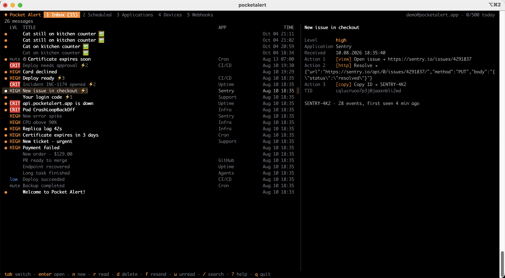

<div align="center">

# Pocket Alert CLI

**Push notifications to your phone from the terminal, scripts and CI.**

Find out when a deploy finishes, a backup fails or a server goes down, without watching logs.

[](https://github.com/PocketAlert/cli/releases/latest)
[](https://github.com/PocketAlert/cli/actions/workflows/release.yml)
[](LICENSE)

[Website](https://pocketalert.app) · [Documentation](https://info.pocketalert.app/cli) · [Releases](https://github.com/PocketAlert/cli/releases)



</div>

## Features

- **Send from anywhere.** Run one command from a shell, a cron job, a Dockerfile or a GitHub Actions step.
- **Never miss a long job.** `pocketalert exec -- make release` notifies you with the exit code, the duration and the last lines of output.
- **Watch logs.** Pipe `tail -f` into `pocketalert watch`; bursts arrive as one push.
- **Alert levels.** Levels run from `silent` to `critical`, and critical alerts get through Do Not Disturb.
- **Action buttons.** Open a URL, call a webhook or copy text right from the notification.
- **Scheduled delivery.** Send at a set time or after a delay, and cancel any time.
- **Interactive mode.** `pocketalert ui` opens a full-screen inbox where you read, search, compose and manage everything from the keyboard.
- **Script-friendly.** Every command supports `--json`, errors go to stderr, and exit codes are reliable.

## Quick start

```bash
# 1. Install
brew install pocketalert/tap/pocketalert

# 2. Paste your API key from https://pocketalert.app/account/apikeys
pocketalert auth

# 3. Send your first notification
pocketalert send "Hello" "It works 🎉"
```

To receive it, install the Pocket Alert app ([iOS](https://apps.apple.com/us/app/pocket-alert/id6446805143), [Android](https://play.google.com/store/apps/details?id=com.pocketalert.app)) and sign in.

## Install

| Method | Command |
|---|---|
| Homebrew (macOS, Linux) | `brew install pocketalert/tap/pocketalert` |
| Script (macOS, Linux) | `curl -fsSL https://raw.githubusercontent.com/PocketAlert/cli/main/install.sh \| sh` |
| Go | `go install github.com/PocketAlert/cli/cmd/pocketalert@latest` |

The script checks the SHA-256 checksum and installs to `/usr/local/bin`, or to `~/.local/bin` if it can't write there. To pin a version, set `POCKETALERT_VERSION=v2.1.0`.

<details>
<summary><b>Manual download</b></summary>

These links always point to the latest release:

| Platform | Archive |
|---|---|
| macOS Apple Silicon | [pocketalert_darwin_arm64.tar.gz](https://github.com/PocketAlert/cli/releases/latest/download/pocketalert_darwin_arm64.tar.gz) |
| macOS Intel | [pocketalert_darwin_amd64.tar.gz](https://github.com/PocketAlert/cli/releases/latest/download/pocketalert_darwin_amd64.tar.gz) |
| Linux x86-64 | [pocketalert_linux_amd64.tar.gz](https://github.com/PocketAlert/cli/releases/latest/download/pocketalert_linux_amd64.tar.gz) |
| Linux ARM64 | [pocketalert_linux_arm64.tar.gz](https://github.com/PocketAlert/cli/releases/latest/download/pocketalert_linux_arm64.tar.gz) |
| Windows x86-64 | [pocketalert_windows_amd64.zip](https://github.com/PocketAlert/cli/releases/latest/download/pocketalert_windows_amd64.zip) |

Checksums: [checksums.txt](https://github.com/PocketAlert/cli/releases/latest/download/checksums.txt).

```bash
tar -xzf pocketalert_*.tar.gz && sudo mv pocketalert /usr/local/bin/
xattr -d com.apple.quarantine /usr/local/bin/pocketalert   # macOS, if Gatekeeper blocks it
```

</details>

## Interactive mode

```bash
pocketalert ui
```

`pocketalert ui` opens a full-screen app:

- a live inbox with a preview pane, search and an unread filter;
- a compose form with every send option;
- scheduled messages, applications, devices and webhooks, including webhook request history.

New messages appear automatically.

| Key | Action |
|---|---|
| `tab`, `1`…`5` | Inbox, Scheduled, Applications, Devices, Webhooks |
| `enter` / `esc` | Open / back. On an application or device: show its messages |
| `n` | New message (`ctrl+s` sends) |
| `f` | Resend or duplicate the selected message |
| `r` / `a` / `u` | Toggle read / mark all read / unread only |
| `d` | Delete, cancel or remove (asks first) |
| `/` | Search |
| `y` | Copy the text, TID or webhook URL |
| `?` | All shortcuts |

## Send notifications

```bash
pocketalert send "Deploy finished" "v1.4.2 is live"
pocketalert send "Disk 95%" "/var is almost full" --level high
df -h | pocketalert send "Disk report"                 # message from stdin
TID=$(pocketalert send "Build" "started" -q)           # print only the TID
```

| Flag | Description |
|---|---|
| `-a, --app <tid>` | Application |
| `-d, --device <tid>` | Device (default: all devices) |
| `-l, --level` | `silent`, `low`, `default`, `high`, `critical` |
| `--action type:label:value` | Button (`view`, `http` or `copy`), up to 3 |
| `--image <file\|url>` | Image attachment |
| `--at <time>` / `--in <delay>` | Schedule: `"2026-10-20 09:00"`, `30m`, `1d12h` |

```bash
# Critical alert with buttons
pocketalert send "Deploy failed" "main@4f2c" -l critical \
  --action "view:Open logs:https://ci.example.com/run/1" \
  --action "http:Retry:https://ci.example.com/run/1/retry" \
  --action "copy:Copy SHA:4f2c9e1"

# Scheduled
pocketalert send "Standup" "In 10 minutes" --at "2026-10-20 09:50"
pocketalert scheduled list
pocketalert scheduled cancel <tid>
```

> The critical level, action buttons, images and scheduling need a paid plan. On the free plan the message is still delivered, and the CLI tells you what was left out.

## Get notified when a command finishes

```bash
pocketalert exec -- make release
pocketalert exec --on failure -l critical -- ./backup.sh
pocketalert exec -t "Nightly import" --tail 20 -- python import.py
```

The command's output shows as usual. When it exits, you get a push with ✓ or ✗, the duration and the last lines of output. `exec` passes the exit code through, so it is safe to use in CI and in `set -e` scripts.

## Watch a log

```bash
tail -f app.log | grep --line-buffered ERROR | pocketalert watch -t "app errors"
journalctl -fu nginx | pocketalert watch --batch 1m -l high
```

Lines that arrive within `--batch` (default 5s) are grouped into one notification. A burst of errors costs one message from your daily quota.

## Recipes

**GitHub Actions**

```yaml
- name: Deploy
  run: pocketalert exec -t "Deploy ${{ github.ref_name }}" -- make deploy
  env:
    POCKETALERT_API_KEY: ${{ secrets.POCKETALERT_API_KEY }}
```

**Cron: alert only when the backup fails**

```cron
0 3 * * * /usr/local/bin/pocketalert exec --on failure -l critical -- /opt/backup.sh
```

**Health check**

```bash
systemctl is-active --quiet nginx || pocketalert send "nginx down" "on $(hostname)" -l critical
```

## Manage your account

```bash
pocketalert messages list | get | read | delete | stats
pocketalert apps     list | get | create | update | delete
pocketalert devices  list | get | rename | delete
pocketalert webhooks list | get | create | update | history | delete
pocketalert forms    list | delete
pocketalert apikeys  list | create | delete
pocketalert usage                     # today's quota
pocketalert profile
```

Every command accepts `--json`, so you can pipe it into `jq`:

```bash
pocketalert messages list --json | jq -r '.data[].title'
```

For all flags, run `pocketalert <command> --help` or see the [full documentation](https://info.pocketalert.app/cli).

## Configuration

`pocketalert auth` saves the key to `~/.pocketalert/config.json` (mode `0600`). Environment variables take precedence, which is handy in CI and containers:

| Variable | Purpose |
|---|---|
| `POCKETALERT_API_KEY` | API key |
| `POCKETALERT_API_URL` | API base URL (default `https://api.pocketalert.app`) |
| `POCKETALERT_CONFIG` | Config file path |

**Shell completion.** Homebrew sets it up automatically. Otherwise:

```bash
pocketalert completion zsh  > "${fpath[1]}/_pocketalert"
pocketalert completion bash > /etc/bash_completion.d/pocketalert
pocketalert completion fish > ~/.config/fish/completions/pocketalert.fish
```

<details>
<summary><b>Development</b></summary>

```bash
make test        # go test -race ./...
make build       # ./pocketalert
make snapshot    # local GoReleaser build into dist/
```

A single workflow, `.github/workflows/release.yml`, runs the tests on Linux, macOS and Windows and then builds with GoReleaser:

- **Push to main:** releases `v<VERSION>` if that tag doesn't exist yet. Bump the version first:
  ```bash
  scripts/bump-version.sh minor      # or patch, major, 2.1.0
  git commit -am "chore: release v2.1.0" && git push
  ```
  If the version is unchanged, the push only runs the checks.
- **Push a tag `v2.1.0`:** releases that tag. It must match `VERSION`.
- **Pull request or manual run:** runs the tests and builds a snapshot artifact without publishing.

</details>

## License

[MIT](LICENSE)
